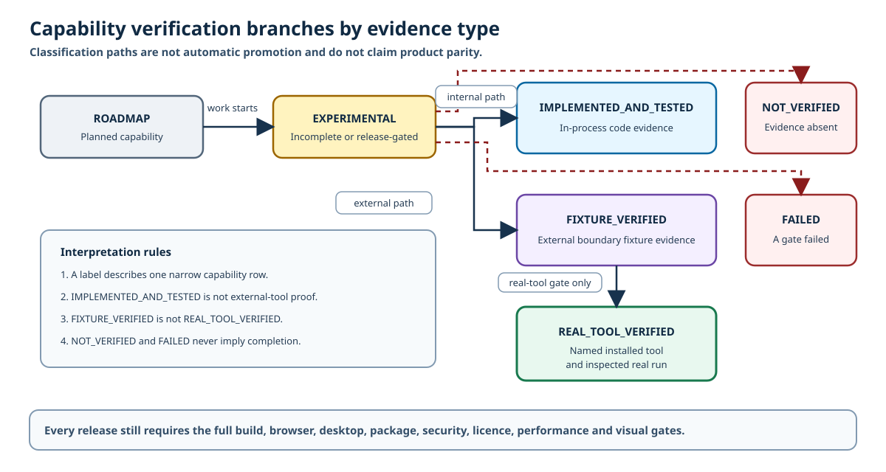
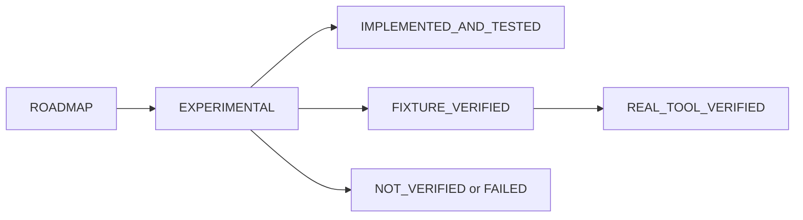

# Engineering Design Studio capability matrix

## Status model

Text equivalent: planned capabilities begin as `ROADMAP`. Incomplete or
release-gated work is `EXPERIMENTAL`. In-process code can become
`IMPLEMENTED_AND_TESTED`. An external boundary can become `FIXTURE_VERIFIED`,
but only a named installed tool and inspected run can become
`REAL_TOOL_VERIFIED`. `NOT_VERIFIED` and `FAILED` never imply completion.

All local authoring, native project storage, implemented open-format exchange
and fixture validation are free and account-free. Future hosted collaboration,
managed backup, hosted compute or commercial data feeds may add convenience,
but cannot be required to open, edit, validate or export a core local project.

## CAD programme

| Capability | User value | Architecture owner | Open format | Dependency and licence | Security boundary | Prerequisite | Acceptance fixture | Performance target | Maturity | Next gate |
|---|---|---|---|---|---|---|---|---|---|---|
| Native CAD v2, migration and history | Deterministic editable ownership, undo/redo and recovery | `src/lib/cad/document.ts` | EML CAD JSON v2 | Project code, MIT | 1 MB JSON, finite SI values, unique IDs, acyclic dependencies, bounded history | Existing template v1 | v1 migration, cycle, dangling IDs, future version, failed rebuild | Common document validation below 250 ms | IMPLEMENTED_AND_TESTED | Complete final browser, desktop and visual release gates |
| STL reference import | Inspect print and legacy meshes | `src/lib/cad/meshImport.ts` worker | ASCII/binary STL | Three.js 0.185.1, MIT | 64 MiB, 2M triangles, content sniff, cancellation, no text decode of binary | CAD v2 assets | 20 mm ASCII cube, coloured binary cube, truncated and large cases | Recorded large-mesh import with responsive cancellation | IMPLEMENTED_AND_TESTED | Record final host timings and pixel inspection |
| 3MF reference import | Preserve declared units, components and materials | Mesh worker and ThreeMFLoader | 3MF Core | Three.js 0.185.1, MIT | 256 entries, 128 MiB expanded, 100:1 ratio, traversal/external relationship rejection | CAD v2 assets | Two-component mm model, 1 in cube, malformed, ZIP bomb, external resource | Bounded reference file below 3 s | IMPLEMENTED_AND_TESTED | Record final host timings and full-render inspection |
| Mesh inspection UI | Fit, orient, measure and explain reference geometry | `CadStudioPage`, `CadViewport` | Session state and EML metadata | Three.js, MIT | Demand render, disposal, route worker termination | STL/3MF import | All mesh fixtures plus import failure with prior view retained | Interactive response below 100 ms excluding import | EXPERIMENTAL | Pass final Playwright, keyboard, zoom, reduced-motion and pixel gates |
| Exact primitives and sketch-to-solid | Create bounded real B-rep designs | `src/lib/cad/brep.ts` worker | EML B-rep v1, STEP | Replicad 0.23.1 MIT; wrapper 0.23.0 MIT; OCCT 7.6 LGPL-2.1 plus exception | One lazy terminable worker, one WASM, typed jobs, 60 s timeout | Native CAD history | Box/cylinder/sphere, XY/XZ/YZ sketch, pad, pocket, revolve | Common fixture rebuild below 500 ms after cold load | IMPLEMENTED_AND_TESTED | Measure cold load, rebuild, tessellation and package smoke |
| Booleans and suppression | Compose and vary exact bodies safely | B-rep worker | EML B-rep v1, STEP | Same single OCCT path | Bounded feature count, dependency order, last-valid result | Exact primitives | Union, subtract, intersect and suppressed invalid feature | Two moderate bodies below 1 s | IMPLEMENTED_AND_TESTED | Add larger adversarial solids and final UI evidence |
| Fillet and chamfer | Apply bounded edge treatment | B-rep worker | EML B-rep v1, STEP | Same single OCCT path | Whole exposed edge set only; no stable-name claim | Exact body | Valid modifier and overlarge invalid fillet rollback | Common modifier below 1 s | EXPERIMENTAL | Add stable explicit edge-selection fixtures before release-grade claim |
| STEP export | Exchange exact simple solids | B-rep worker | STEP | Same single OCCT path | Worker timeout and user-initiated export | Exact worker | Export simple sketch/boolean solid with ISO-10303 content | Common part below 5 s | IMPLEMENTED_AND_TESTED | Independently reopen and compare dimensions in a trusted tool |
| STEP tessellated preview | Inspect an exchanged shape with explicit fidelity limits | B-rep worker | STEP input to transferable mesh | Same single OCCT path | 100 MiB cap, assumed mm, exact shape deleted, explicit loss metadata | Exact worker | Export/reimport simple solid and verify all four fidelity flags | 20 MiB part below 10 s | IMPLEMENTED_AND_TESTED | Record final UI notice, timing and cancellation evidence |
| STEP import as immutable B-rep | Retain exact exchange authority without invented history | Future single-kernel adapter | STEP | No second kernel authorised | Must retain exact source authority, hierarchy, units and loss metadata | One-kernel path | Plate with hole, assembly metadata, units and malformed file | 20 MiB part below 10 s | NOT_VERIFIED | Prove retained exact topology and hierarchy before enabling |
| IGES and BREP import | Reuse older exact geometry | Future selected-kernel adapter | IGES, BREP | Selected Replicad API does not expose import; no second kernel authorised | Explicit unsupported result | One-kernel decision | Valid and malformed IGES/BREP | Target below 10 s for 20 MiB part | ROADMAP | Prove support in one reviewed kernel or keep unsupported |
| General 2D constraints and dimension driving | Edit design intent rather than coordinates | Future sketch solver | EML CAD JSON | Solver undecided; GPL solver not authorised | Bounded iterations, conflict diagnostics, no user code | Exact sketch slice | constrained, underconstrained, conflicting and redundant systems | 100 entities below 250 ms | ROADMAP | Approve solver architecture and licence |
| Stable references and topological naming | Preserve downstream selections across rebuilds | Future naming service | EML CAD JSON | No dependency selected | Never silently remap ambiguous topology | Deterministic B-rep history | split/merge face and vanished edge corpus | Naming overhead below 20% of rebuild | ROADMAP | Define identity strategy and adversarial corpus |
| Multi-body and derived/reference geometry | Design related bodies in one part | Future body graph | EML CAD JSON, STEP | Single OCCT path if sufficient | Bounded body/dependency graph | Stable references | two-body derived sketch and circular dependency | 50-body common part interactive | ROADMAP | Define body ownership and recompute rules |
| Assemblies, mates, interference and exploded views | Validate multi-part fit | Future assembly module | EML assembly JSON, STEP | Solver undecided | Bounded graph and no arbitrary scripts | Stable single-part CAD | simple mate, conflict, interference and explosion | 100 parts interactive target | ROADMAP | Approve schema and solver scope |
| Technical drawings, sections, dimensions, tolerances, PDF and DXF | Communicate manufacturing intent | Future drawing module | PDF, DXF, SVG | Standards and renderer review required | No standards-compliance claim | Exact stable geometry | A3 orthographic, section, clipped dimension and tolerance fixtures | A3 render below 2 s | ROADMAP | Define standards subset and independent print inspection |
| Advanced surfacing, loft, sweep and repair | Create and recover complex shapes | Future exact-feature module | STEP, IGES, BREP | Single OCCT path subject to proof | Bounded tolerances and failure rollback | Stable references | guide-curve sweep, loft singularity and gap repair | Fixture target pending | ROADMAP | Define topology and tolerance acceptance |
| Sheet metal, bends, flat patterns and DXF | Design folded parts and manufacturing flats | Future sheet-metal module | EML CAD JSON, DXF, STEP | Dependency undecided | Explicit bend model and material assumptions | Stable exact geometry | bend allowance, relief and round-trip flat pattern | Common part below 2 s | ROADMAP | Select bend model and validate against reference parts |
| Material library, mass properties and centre of gravity | Estimate physical behaviour | Future material and exact-property service | EML JSON, CSV | Licence-aware sources required | Provenance, units and no design-allowable claim | Closed exact solids | density, multi-body mass and transformed centre of gravity | 100 bodies below 500 ms | ROADMAP | Approve sources and compare independent calculations |
| CAM toolpaths and post-processing | Prepare manufacturing operations | Future CAM adapter | STEP, G-code subset | Kernel and postprocessor review required | Simulation first, machine-safe warnings, no automatic machine send | Stable exact geometry | stock, collision, units, unsafe feed and post fixtures | Simulation target pending | ROADMAP | Threat-model posts and define machine acceptance |
| FEM and CFD adapters | Analyse bounded models with provenance | Future controlled solver adapters | STEP, mesh and result JSON | User-installed solvers, licences undecided | Typed adapters, workspace containment, no generic shell | Stable geometry and materials | known analytic cases, malformed and stale solver outputs | Solver-specific budget | ROADMAP | Choose solvers and validation benchmarks |
| Version comparison, branching, collaboration and review | Review change without cloud lock-in | Future local revision layer | EML JSON and open diff | No provider authorised | Local-first, explicit identity/privacy for hosted option | Stable canonical documents | structural diff, conflict and offline branch | 10k-feature diff below 1 s | ROADMAP | Define local revision model before hosted provider |
| OBJ, glTF, DXF, SVG and OpenSCAD interoperability | Move view and drawing data to other tools | Format-specific adapters | OBJ, glTF, DXF, SVG, OpenSCAD | Existing template SVG/OpenSCAD retained; others undecided | User-initiated bounded import/export and loss reports | Format semantics | one golden and one hostile case per format | Common file below 3 s | ROADMAP | Define each subset separately; never claim blanket round trip |

## EDA programme

| Capability | User value | Architecture owner | Open format | Dependency and licence | Security boundary | Prerequisite | Acceptance fixture | Performance target | Maturity | Next gate |
|---|---|---|---|---|---|---|---|---|---|---|
| Native EDA v1, command history and persistence | Own editable schematic and board intent | `src/lib/eda/document.ts`, `commands.ts` | EML EDA JSON v1 | Project code, MIT | Finite mm geometry, strict IDs/references, 100-entry default history | EDA types | valid, duplicate/dangling, future version, grouped undo/redo | 10k objects below 300 ms | IMPLEMENTED_AND_TESTED | Pass final UI save/reopen and desktop persistence gates |
| Original offline palette | Place basic circuits without copied libraries | `src/lib/eda/palette.ts` | EML EDA JSON | Original project data, MIT | Static reviewed resistor, capacitor, diode, LED, source, ground, connector and IC blocks | Native document | palette integrity and stable IDs | Load below 50 ms | IMPLEMENTED_AND_TESTED | Add visual and accessibility inspection |
| Schematic authoring UI | Place, move, rotate, edit, wire, label and mark no-connect | `EdaStudioPage` and command model | EML EDA JSON | No new dependency | Bounded commands, snap grid, no executable content | Palette and history | empty-to-voltage-divider plus save/reopen | Interaction below 100 ms | EXPERIMENTAL | Pass full pointer, keyboard, zoom and pixel acceptance |
| Connectivity, annotation, BOM and netlist | Derive deterministic electrical intent | `connectivity.ts`, `document.ts` | EML EDA JSON, CSV, text netlist | Project code, MIT | Junction semantics, unique references, no supplier fetch | Valid schematic | voltage divider, crossings, labels, duplicate designators | 10k nodes below 500 ms | IMPLEMENTED_AND_TESTED | Inspect UI-to-text agreement on authored fixture |
| Basic in-app ERC | Surface missing and conflicting connections | `connectivity.ts` | Diagnostic JSON | Project code, MIT | Declared pin types only; no electrical-safety claim | Connectivity graph | unconnected required pin, conflicting output/power and repaired design | 10k nodes below 500 ms | IMPLEMENTED_AND_TESTED | Pass same-document UI repair and focus-link visual gate |
| Two-layer PCB authoring and ratsnest | Place footprints, route 45-degree tracks and vias | `pcb.ts`, commands and EDA UI | EML EDA JSON | Project code, MIT | F.Cu/B.Cu only, finite positive rules, pad-net preservation | Schematic-footprint mapping | empty-to-routed LED board with via and reopen | 20k segments interactive target | EXPERIMENTAL | Pass end-to-end UI authoring and visual inspection |
| Basic in-app DRC | Catch width, clearance, edge and unconnected defects | `pcb.ts` | Diagnostic JSON | Project code, MIT | Bounded geometry subset; no fabrication approval | Valid two-layer board | LED deliberate defect, repaired recheck, crossing and concave-edge cases | 20k primitives below 2 s | IMPLEMENTED_AND_TESTED | Confirm all detector controls and UI repair in final suite |
| BOM and pick-and-place | Produce readable local assembly data | `document.ts` and EDA UI | CSV/JSON preview | Project code, MIT | Verified fields, explicit mm/degrees/side, no procurement claim | Annotated schematic and placed footprints | voltage divider BOM, front/back rotations | 10k items below 200 ms | IMPLEMENTED_AND_TESTED | Add download/reopen contract and external viewer check |
| KiCad 6+ schematic and PCB semantic subset | Reuse supported open designs with visible loss | `interchange.ts` | `.kicad_sch`, `.kicad_pcb` | Format docs only; KiCad not bundled | 10 MB, 200k nodes, depth 64, bounded atoms/strings, explicit loss acknowledgement | Native EDA v1 | independent KiCad 7/8/9/10 projects, hostile parser, unsupported hierarchy/zones/rules | Common project below 2 s | IMPLEMENTED_AND_TESTED | Validate generated files with a real installed KiCad |
| KiCad CLI ERC, DRC, netlist, BOM, Gerber, drill and render | Obtain authoritative external outputs | Existing KiCad adapter and Rust mapping | KiCad files, reports, Gerber, Excellon | User-installed GPL-3.0-or-later tool, not bundled | Exact tool ID, fixed args, workspace zones, unique result directory, freshness and hashes | Compatible authorised desktop tool | KiCad 7/8/9/10 command and stale-output fixtures | Existing adapter timeout/output caps | FIXTURE_VERIFIED | Install/detect named KiCad and inspect all seven outputs |
| Controlled voltage-divider ngspice path | Inspect a bounded simulation with accessible table | `interchange.ts` and existing ngspice adapter | SPICE text and result series | User-installed ngspice, not bundled | Generated grammar only, no control/include/library/shell directives | Valid voltage divider | fixed deck and bounded 10 V to 5 V result table | Existing adapter timeout/output caps | FIXTURE_VERIFIED | Run compatible installed ngspice and compare parsed result |
| Hierarchical/multi-sheet schematics, buses and reusable blocks | Scale circuit organisation | Future schematic hierarchy | EML EDA JSON, KiCad subset | No dependency selected | Bounded hierarchy, explicit scope and loss | Stable flat schematic | nested sheets, buses, repeated block references | 100 sheets interactive target | ROADMAP | Extend schema and KiCad loss semantics |
| Licence-aware symbol and footprint library management | Reuse trusted parts | Future library manager | EML library JSON, KiCad library subset | Source-by-source licence acceptance required | No registry code, macros or auto-fetch | Original palette | attribution, conflict, malicious archive and offline cases | 10k entries below 1 s | ROADMAP | Define provenance and share-alike policy |
| Annotation, BOM variants and design reuse | Manage product variants | Future variant service | EML EDA JSON, CSV | Project code unless source data added | Deterministic variant filters and missing-field warnings | Stable references | fitted/not-fitted variants and reused blocks | 10k items below 300 ms | ROADMAP | Define variant schema and comparison fixtures |
| SPICE models, analyses, probes and comparison | Analyse more than the fixed divider | Future bounded simulation domain | SPICE subset and result JSON | Model licences require review | No arbitrary includes/control/code; typed analyses only | Controlled ngspice seam | operating point, DC, AC, transient, unsupported model and stale result | Analysis-specific budget | ROADMAP | Approve device/model grammar and reference benchmarks |
| Multilayer stack-up, planes, zones and impedance | Design more complex boards | Future PCB stack-up and fill engine | EML EDA JSON, KiCad subset | Algorithm/source review required | Bounded layers and deterministic fill | Two-layer PCB | four-layer stack, zone island and impedance assumptions | Project-specific target | ROADMAP | Define stack-up and validated field model |
| Differential pairs, length tuning, net classes and advanced DRC | Enforce high-speed intent | Future rules and router modules | EML EDA JSON, KiCad subset | Dependency undecided | Explicit tolerances and no SI certification claim | Advanced stack-up | pair gap, skew, tuning and class conflict | 20k primitives below 2 s target | ROADMAP | Define rules and independent reference cases |
| Interactive routing, shove, keepouts and autorouter decision | Route dense boards honestly | Future router | EML EDA JSON, KiCad subset | Algorithm/licence decision pending | No uncontrolled plugin or network solver | Advanced DRC | shove obstacle, keepout, via transition and unreachable route | 60 fps interaction target | ROADMAP | Benchmark interactive router before deciding autorouter |
| 3D board/enclosure co-design and clearance | Check electromechanical fit | Future CAD/EDA scene adapter | STEP, glTF, EML JSON | Existing Three.js and one OCCT path if sufficient | Local bounded models and explicit clearance tolerance | Stable CAD and PCB geometry | board, connector, enclosure and collision | Common assembly interactive target | ROADMAP | Define package-model provenance and collision fixtures |
| Panels, test points, DFM, Gerber X2, drill, IPC-356 and pick-and-place | Prepare fabrication handoff | Future manufacturing module or controlled KiCad | Gerber X2, Excellon, IPC-356, CSV | Route and tool licences must be reviewed | No automatic submission; independent viewer required | Advanced DRC | panel tabs, drills, netlist and coordinate convention | Common board below 5 s | ROADMAP | Select native versus KiCad path per output |
| Eagle interchange | Reuse Eagle designs | Future independent converter | Eagle XML subset | Format and sample licences require review | Bounded XML without external entities, loss report | Stable EDA schema | simple schematic/board and unsupported library cases | Common file below 3 s | ROADMAP | Define tested subset and legal samples |
| EasyEDA interchange | Reuse EasyEDA designs | Future independent converter | Documented JSON subset where lawful | Terms and format provenance review required | No account, scraping, remote code or registry fetch | Stable EDA schema | exported local sample and unsupported construct | Common file below 3 s | ROADMAP | Approve source/terms and define subset |
| Altium interchange | Recover bounded neutral intent | Future independent converter | ODB++, IPC-2581 or lawful export subset | Proprietary format and sample rights review required | No blanket parser or round-trip claim | Stable EDA schema | user-authorised neutral exports and loss corpus | Target pending | ROADMAP | Choose open export path, not proprietary parity |
| Hosted collaboration, backup and review | Add optional convenience without file lock-in | Future provider-neutral boundary | EML JSON and open exports | Provider not selected | Explicit identity, tenancy, privacy, encryption and export controls | Local revision model | offline continuity, conflict, export and provider outage | Service target pending | ROADMAP | Complete provider, privacy and threat-model approval |

## Release interpretation

1. The maturity label describes the narrow row, not the whole product or a
   parity claim.
2. `IMPLEMENTED_AND_TESTED` still requires the final full-tree build, browser,
   desktop, package, security, licence, performance and visual gates before a
   release or push decision.
3. KiCad and ngspice remain `FIXTURE_VERIFIED` and real-tool `NOT_VERIFIED` on
   the current host.
4. Any final-tree test, licence, security, one-WASM, offline or visual failure
   changes the affected row to `FAILED` or `NOT_VERIFIED`; it is never waived by
   a roadmap statement.
