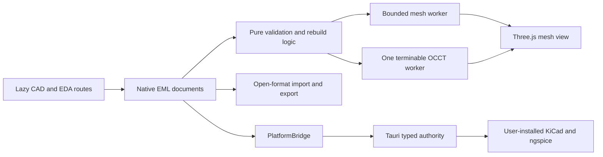

# Engineering Design Studio

## Purpose and status

Engineering Design Studio is the local-first CAD and EDA product boundary for Engineering Mastery Lab. This document describes the implemented branch-local vertical slices and the release-gated roadmap. It is not a final release claim. Capability status is authoritative only when read with `Engineering-Design-Capability-Matrix.md` and current final-tree evidence.

Core authoring, local persistence, validation and open-format export have a free and offline-capable baseline. No account, billing, telemetry, remote code or hosted service is required. Future hosted identity, synchronisation, collaboration, cohort services and analytics are optional categories only. They remain unavailable and must not become prerequisites for local work.

## Architecture

Ordered text equivalent:

1. Lazy CAD and EDA routes edit native Engineering Mastery Lab documents.
2. Pure TypeScript modules validate documents, build connectivity and rebuild ordered features.
3. A mesh worker preflights and analyses STL/3MF; a separate exact worker owns all OCCT initialisation and modelling.
4. Three.js displays tessellated meshes. It is not the exact modelling authority.
5. Open-format adapters import and export bounded data without changing native ownership.
6. Desktop-only file and process operations cross `PlatformBridge`.
7. Tauri enforces typed requests, authorised workspace roots, fixed arguments, path containment, cancellation, timeouts and output caps.
8. KiCad and ngspice remain separately installed tools. Fixture evidence and real-tool evidence are reported separately.

## Geometry authority

The following three concepts are deliberately distinct:

| Concept | Meaning | Editable authority | Permitted use |
|---|---|---|---|
| Mesh reference | Tessellated triangles imported from STL or 3MF | None. It is `referenceOnly` | Visual reference, measurement support and alignment after explicit unit handling |
| STEP tessellated preview | Triangle display generated from STEP | None; exact shape is deleted after tessellation | Tested with assumed-mm notice and explicit losses for topology, hierarchy, source units and features |
| Immutable exchange B-rep | Intended exact exchange authority | No native feature history is inferred | `NOT_VERIFIED`; IGES/BREP import are unsupported |
| Native parametric history | Ordered EML features, parameters, dependencies and stable document identifiers | EML CAD document | Edit parameters, rebuild, undo and redo, while retaining the last valid result after a failed feature |

Converting a mesh or exchange B-rep into native parametric history is not automatic and must never be implied. Topological naming is not claimed as solved. A dangling or unstable face, edge or vertex selection must be identified, and a failed rebuild must retain the last valid shape rather than silently corrupt downstream work.

Three.js is the renderer and mesh-interchange layer: <https://threejs.org/docs/>. The selected exact-kernel path is `replicad@0.23.1` with `replicad-opencascadejs@0.23.0` and the single `replicad_single.wasm` OCCT 7.6 payload. It loads only through the dedicated CAD worker. Package-content, source, licence, replaceability and current limitations are recorded in `Third-Party-Licences.md` and `Source-Register.md`. Final built and packaged output must still prove one emitted OCCT WASM and pass browser and desktop smoke gates.

## Document and unit rules

### CAD

- Native CAD document version 2 uses millimetres for length, radians for angle, kilograms per cubic metre for density, and explicit `count` or `ratio` scalar parameters.
- All numbers must be finite. Identifiers and dependency order must validate before rebuild or persistence.
- STL is unitless. Import requires an explicit source-unit interpretation. Exported STL coordinates follow the document millimetre convention, and the receiving tool must also be set to millimetres.
- 3MF declares a model unit. Import normalises supported units to millimetres and records the source unit and scale.
- Mesh assets remain reference-only and retain SHA-256, byte count, format and preflight metadata.
- Exchange B-reps are immutable unless a later, explicit capability provides a controlled derived feature.
- The tested exact slice supports primitives; XY/XZ/YZ line, polyline, rectangle, circle and arc sketches; construction geometry; pad/extrude, pocket, revolve, union/subtract/intersect, suppression, rollback and STL/STEP export. STEP tessellated preview is tested; exact immutable-base import remains `NOT_VERIFIED`.
- Fillet and chamfer exist only as an experimental whole-edge-set operation until stable selected-edge fixtures pass.

### EDA

- Native EDA document version 1 owns schematic and PCB intent in neutral EML JSON.
- Schematic and PCB coordinates and physical rules use millimetres. Rotation is stored in degrees using the bounded values permitted by the schema.
- Electrical quantities exported to SPICE use explicit SI values and suffix semantics. A parser must not silently reinterpret a value.
- Stable IDs, unique annotated references, finite geometry, footprint links and pad mappings must validate before canonical persistence or export.
- A KiCad import or export is a bounded subset conversion, not native KiCad parity. Unsupported or approximated content produces a deterministic loss report.
- The local palette covers resistor, capacitor, diode, LED, source, ground, connector and generic IC blocks/footprints without copying a third-party library.

## Runtime and security boundaries

- Browser mode supports local in-memory or browser-profile work and explicit user import or download. It cannot execute installed tools or access an arbitrary workspace.
- Desktop mode may persist beneath an exact user-selected workspace root through `PlatformBridge` only.
- The renderer cannot choose arbitrary executables, arguments, paths or environment variables. It receives no shell, opener, generic process or broad filesystem capability.
- Tauri tool execution uses existing exact tool IDs, executable selection, fixed argument mappings, canonical containment, symlink and junction rejection, cancellation, output limits and SHA-256 evidence.
- Input budgets, archive budgets, triangle budgets and worker timeouts fail closed. Traversal, absolute paths, backslashes, unsafe URI schemes, external 3MF relationships, encrypted entries, unsupported archive methods, non-finite geometry, duplicate IDs, dangling references and future document versions are rejected.
- KiCad S-expression parsing is capped at 10,000,000 bytes, 200,000 nodes, depth 64, string length 65,536 and atom length 1,024.
- Native files, imported archives and tool output are untrusted data. Embedded instructions, scripts or control directives do not gain authority.
- The Academy production service worker excludes CAD, EDA and OCCT assets. Academy offline evidence is not CAD/EDA cold-start offline evidence. A packaged desktop build is a separate boundary.
- About exposes the exact-CAD notice plus four licence texts and the two source/licence registers as same-origin assets. Final web and desktop builds must prove all six files are emitted and readable.

## Workspace layout and accessible equivalents

| Workspace | Left | Centre | Right | Bottom |
|---|---|---|---|---|
| CAD | Model tree and fixture/import controls | Demand-rendered mesh or OCCT tessellation viewport | Feature, selection, transform, bounds and unit properties | Feature history, worker progress, rebuild failures and diagnostics |
| EDA | Original offline symbol/footprint palette | Schematic and PCB tabs with snap grid | Selected properties, nets, rules and layer controls | ERC, DRC, simulation fixture, fabrication previews and evidence state |

Model trees, feature history, nets, diagnostics, measurements, BOM,
pick-and-place and simulation series require semantic list or table equivalents.
Pointer actions require labelled keyboard controls. Units remain visible. A
canvas or successful screenshot alone is not acceptance evidence; the final
visual gate must inspect actual pixels and compare the accessible text.

## Free and offline baseline

Local CAD and EDA authoring, native EML JSON, implemented open-format
import/export and deterministic fixture validation have no account, billing,
telemetry or hosted dependency. Browser import/download stays within the
browser profile and user-selected files. Desktop workspace persistence and
external tools require the existing session authority. Future hosted compute,
collaboration, managed backup or commercial data feeds cannot become a gate to
opening, editing, validating or exporting a core local project.

## Evidence labels

Only these status labels may be used: `IMPLEMENTED_AND_TESTED`, `FIXTURE_VERIFIED`, `REAL_TOOL_VERIFIED`, `EXPERIMENTAL`, `ROADMAP`, `NOT_VERIFIED` and `FAILED`.

- `IMPLEMENTED_AND_TESTED` means current-session or retained automated tests exercise the in-process implementation.
- `FIXTURE_VERIFIED` means deterministic fixture tests exercise an external-tool adapter or conversion boundary without proving that the real tool ran.
- `REAL_TOOL_VERIFIED` requires a compatible installed tool, captured version, controlled end-to-end execution and inspected outputs.
- `EXPERIMENTAL` identifies unfinished branch-local foundations that have not passed the complete release gate.
- `ROADMAP` identifies planned capability with no implementation claim.
- `NOT_VERIFIED` identifies an applicable check that has not been run or cannot currently be evidenced.
- `FAILED` identifies an executed acceptance check that failed.

## Performance and failure budgets

| Resource | Initial boundary |
|---|---:|
| Input file | 64 MiB |
| 3MF entries | 256 |
| 3MF total expanded content | 128 MiB |
| 3MF single expanded entry | 128 MiB |
| 3MF per-entry compression ratio | 100:1 |
| Rendered mesh triangles | 2,000,000 |
| CAD command history | 50 entries by default |
| EDA command history | 100 entries by default, hard configuration ceiling 1,000 |
| Exact-kernel job | 60 s timeout |
| CAD route workers | One mesh worker plus one exact-kernel worker maximum |

These are acceptance limits, not measured performance results. The capability matrix defines the next gate for each relevant feature.

### Branch-local performance measurements

Measured on 9 August 2026 in the current Windows checkout with Node 24.18.0 and bundled headless Chromium 151.0.7922.34. Hardware inventory was unavailable to the restricted process, so these values are reproducibility evidence for this machine and session, not cross-device targets. The production manifest at `dist/.vite/manifest.json` was newer than the inspected CAD route, EDA route, kernel and worker sources. No rebuild was run because that existing source-current output supplied the requested size evidence without mutating concurrent work.

Production sizes use exact file bytes. Gzip values were recomputed with Node's level-9 `zlib.gzipSync`; Brotli is included for the WASM payload only. The initial static graph is the main entry, its recursive static JavaScript imports and its CSS, counted once. Lazy-route values are the route entry files and exclude shared initial imports.

| Production boundary | File or graph | Raw bytes | Gzip bytes | Status |
|---|---|---:|---:|---|
| Historical initial bundle before this branch | No retained source-matched production artefact | Unknown | Unknown | `NOT_VERIFIED` |
| Current main entry | `index-DLk6B7Hg.js` | 455,193 | 136,755 | Measured |
| Current initial static graph | Six unique JS/CSS files | 1,164,077 | 237,182 | Measured |
| Lazy CAD route | `CadStudioPage-BKa5NoSf.js` | 697,761 | 177,138 | Measured |
| Lazy EDA route | `EdaStudioPage-Bd0FdXev.js` | 120,001 | 32,279 | Measured |
| Exact-CAD worker | `brep.worker-BjUwe320.js` | 396,112 | 120,753 | Measured |
| Mesh-import worker | `meshImport.worker-CpqNBEW-.js` | 133,907 | 39,782 | Measured |
| Single OCCT WASM | `replicad_single-ko7rBbsE.wasm` | 10,855,736 | 4,568,469 | Measured; Brotli 3,382,379 bytes |

The manifest contained exactly one `.wasm` file. The historical before value remains unverified because rebuilding an old tree against the current dirty checkout and dependency installation would not provide a safe source-matched baseline. No percentage change is claimed.

The browser timing probe served the existing production output on loopback, opened `#/tools/cad`, and timed visible completion states with `Date.now()`. The cold exact measurement starts immediately before invoking the documented pad-and-pocket fixture in a new page and ends when the exact-worker diagnostic reports `complete: model rebuilt`; it includes worker creation, OCCT/WASM initialisation, feature rebuild, tessellation, transferable delivery and React presentation. The warm measurement repeats `Rebuild exact model` in the same worker. The runtime returns rebuild and tessellation atomically, so a tessellation-only clock is `NOT_VERIFIED`; the measured combined value is reported without splitting it.

| Fixture and boundary | Measured time | Interpretation |
|---|---:|---|
| Cold exact worker, sketch-pad-pocket rebuild and tessellation | 706 ms | End-to-end cold route measurement |
| Warm sketch-pad-pocket rebuild and tessellation | 229 ms | End-to-end same-worker measurement |
| Focused in-process sketch-pad-pocket evaluation | 122 ms | Vitest case duration; rebuild and tessellation remain combined |
| Focused 600,000-triangle STL import | 156 ms | In-process loader and analysis test duration |
| Focused 600,000-triangle render-payload construction | 214 ms | In-process transferable-payload test duration |
| 600,000-triangle STL import, worker transfer and visible render | 3,808 ms | Browser end-to-end time for a 30,000,084-byte fixture |
| Tessellation only | Unknown | `NOT_VERIFIED`; no separate instrumented boundary exists |

The named memory indicator is the **renderer `usedJSHeapSize` sampled peak proxy**. Chromium was launched with precise memory information and the page heap was sampled every 20 ms while each operation was pending, with the before and after samples also included. It is not process peak resident memory and does not include a separately attributable worker heap, WASM linear memory, GPU memory or driver allocations. The cold exact operation reached 12,496,962 bytes by completion. The large-mesh operation reached a sampled peak of 398,245,556 bytes and ended at 327,818,028 bytes. These are diagnostic proxies, not release memory budgets.

Detector adequacy was challenged in the same focused run. Truncated STL, truncated 3MF, ZIP-bomb metadata, external 3MF relationships, explicit format mismatch and an over-limit triangle declaration were all rejected before unsafe loading or allocation. The two focused files completed 56 of 56 tests. Size detection also enumerated the manifest rather than accepting a configured filename and returned exactly one emitted WASM. Browser resource timing did not expose the worker-owned WASM request in the page resource timeline, so cold-load evidence uses the end-to-end visible completion clock and emitted-file size rather than inventing a WASM-fetch duration.

## Current maturity summary

| Surface | Narrow evidence | Maturity |
|---|---|---|
| CAD v2, STL/3MF and exact OCCT domain | Focused deterministic and real-WASM tests | `IMPLEMENTED_AND_TESTED` for the tested domain subset |
| CAD route interaction and visual acceptance | Final full visual and package gate pending | `EXPERIMENTAL` |
| EDA v1, connectivity, ERC, DRC, outputs | Deterministic domain tests | `IMPLEMENTED_AND_TESTED` for the tested domain subset |
| EDA route authoring and visual acceptance | Final end-to-end visual gate pending | `EXPERIMENTAL` |
| KiCad semantic subset | Bounded in-process parser/export tests | `IMPLEMENTED_AND_TESTED`; real KiCad acceptance `NOT_VERIFIED` |
| KiCad and ngspice adapters | Deterministic external-boundary fixtures | `FIXTURE_VERIFIED`; real tools `NOT_VERIFIED` |

## Optional future hosted categories

Hosted identity, synchronisation, collaboration, review, cohort services and analytics may be described as future provider categories. They remain unavailable, must use explicit privacy and tenancy controls if ever authorised, and must not introduce billing into the Engineering Design Studio baseline. Local documents and open exports remain usable without them.
