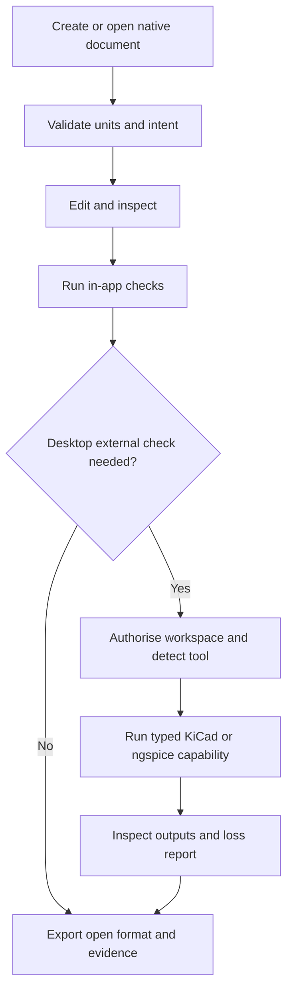

# Engineering Design Studio user workflow

## Local-first workflow

Text equivalent:

1. Create a new native EML CAD or EDA document, or import a supported file.
2. Confirm the document units and the intended authority of imported content.
3. Edit native parameters or circuit intent and inspect the result.
4. Resolve native validation, rebuild, ERC or DRC diagnostics that apply.
5. If no external tool is required, export an open format and retain the evidence report.
6. If KiCad or ngspice is required, use desktop mode, select the exact workspace and detect the separately installed tool.
7. Run only the named typed capability and wait for a terminal result.
8. Inspect generated files, warnings, unsupported-content loss entries and engineering assumptions before accepting the output.

## CAD workflow

1. Start with a native template or native CAD document.
2. Confirm that native dimensions are millimetres and angles are radians.
3. When importing STL, explicitly choose its source unit because STL contains no unit metadata.
4. Treat STL and 3MF as mesh references. They can support visual comparison and measurement, but they are not exact solids or editable feature history.
   Imported mesh bytes may be retained in a bounded, SHA-256-keyed browser-profile cache so saved metadata can reopen without reselection. Use `Clear cached mesh files` to delete those blobs; the current in-memory mesh remains visible, but a later reopen requires the source file again.
5. STEP export and an explicitly lossy STEP tessellated preview are available. The preview assumes millimetres and declares that exact topology, hierarchy, source units and features are not retained. Do not treat it as an immutable exact base. IGES and BREP are unsupported.
6. Edit one feature at a time and inspect rebuild diagnostics. If a feature fails, use the retained last valid result only as a recovery reference, not as proof the current model is valid.
7. Before manufacture, inspect the exported file in the production CAD or CAM system and independently verify units, geometry, tolerances and process constraints.

## EDA workflow

1. Create the native EDA document and place only reviewed local palette items.
2. Annotate references, wire pins, place junctions deliberately and mark intentional no-connects.
3. Run native validation and ERC. Review every diagnostic; a clean bounded ERC is not an electrical safety or standards approval.
4. Assign footprints, place them within the board outline and confirm pin-to-pad mappings.
5. Route supported copper layers and run the available DRC subset. Independently verify stack-up, creepage, clearance, current capacity, return paths, thermal behaviour and manufacturing constraints.
6. Generate BOM and pick-and-place output only after checking values, packages, side and rotation conventions.
7. For ngspice, generate the bounded voltage-divider deck and run it through the controlled desktop adapter only when a compatible executable is authorised. Inspect assumptions, model limits and plots.
8. For KiCad exchange, read the complete loss report and explicitly acknowledge it before any lossy re-export. Stop if an omitted or approximated construct could change electrical or physical intent.
9. Inspect Gerber and drill output in an independent viewer before fabrication. No application result authorises ordering or manufacturing.

## Browser and desktop boundaries

| Capability | Browser | Tauri desktop |
|---|---|---|
| Native authoring and validation | Local web state and explicit file import or download | Packaged local frontend |
| Arbitrary workspace access | Unavailable | Exact user-selected authorised root only |
| Installed KiCad or ngspice | Unavailable | Typed controlled adapters only |
| General shell, arbitrary executable or arguments | Unavailable | Unavailable |
| Hosted account, billing or telemetry | Unavailable | Unavailable |
| Academy service-worker offline cache | Academy content only | Not used by packaged desktop assets |

## Troubleshooting

### An STL imports at the wrong size

STL has no unit. Re-import it with the source unit used by the producer, then verify a known dimension. Do not repair the mismatch by assuming the receiving application will infer units.

### A 3MF file is rejected before rendering

The archive may exceed entry, expansion or compression-ratio budgets, contain an unsafe path, use encryption or an unsupported compression method, or reference an external resource. Inspect it in a trusted isolated tool and export a self-contained bounded 3MF. Do not weaken the gate for an untrusted file.

### A CAD feature fails after an upstream edit

Inspect the first failing feature and any face, edge or vertex selection it uses. Topological naming is not claimed as stable. The displayed last valid shape is recovery context only. Repair or replace the selection, then rebuild from the original acceptance case.

### Imported STEP has no editable history

The STEP preview is not an immutable exact base. It assumes millimetres and declares that exact topology, hierarchy, source units and features are not retained. Keep the source document and use a trusted CAD tool for exact inspection. IGES and BREP import are not supported by the selected one-kernel path.

### A KiCad import reports losses

Read every entry and its `preserved` field. If the loss affects connectivity, footprint mapping, layers, zones, rules or fabrication intent, stop and continue in KiCad or simplify the source deliberately. Do not treat `lossy-with-report` as lossless.

### KiCad or ngspice is not detected

Browser mode cannot execute installed tools. In desktop mode, install a compatible tool separately, then select or detect its executable through Diagnostics. Do not browse to an unrelated binary. A fixture pass does not prove the local installation.

### A real-tool run is blocked

Check that the exact workspace is authorised, the input resides in the declared input zone, the output path is in the declared output zone, the extension matches the capability and no symlink or junction crosses the root. Do not move the workspace boundary or weaken containment to force a pass.

### A real-tool run succeeds but output looks incomplete

Check truncation, timeout, cancellation, exit status, tool version and parser diagnostics. Preserve the raw bounded output and generated files. Record the result as failed or not verified until the expected engineering content is independently inspected.

### The browser loses a draft

Browser or webview profile storage is not a version-control or backup system. Export the native EML JSON explicitly at meaningful checkpoints. Desktop persistence must use a user-authorised workspace and atomic writes once that integration is verified.

## Stop conditions

Stop the workflow and retain the last known valid artefact when:

- units are unknown or inconsistent;
- validation, rebuild, ERC or DRC reports a material unresolved error;
- an import loss could change engineering intent;
- a tool version is unsupported or not captured;
- an output is truncated, cancelled, timed out or not independently readable;
- a path, archive, URI or executable request crosses the authority boundary;
- fabrication, safety, regulatory or production acceptance depends solely on this application.
